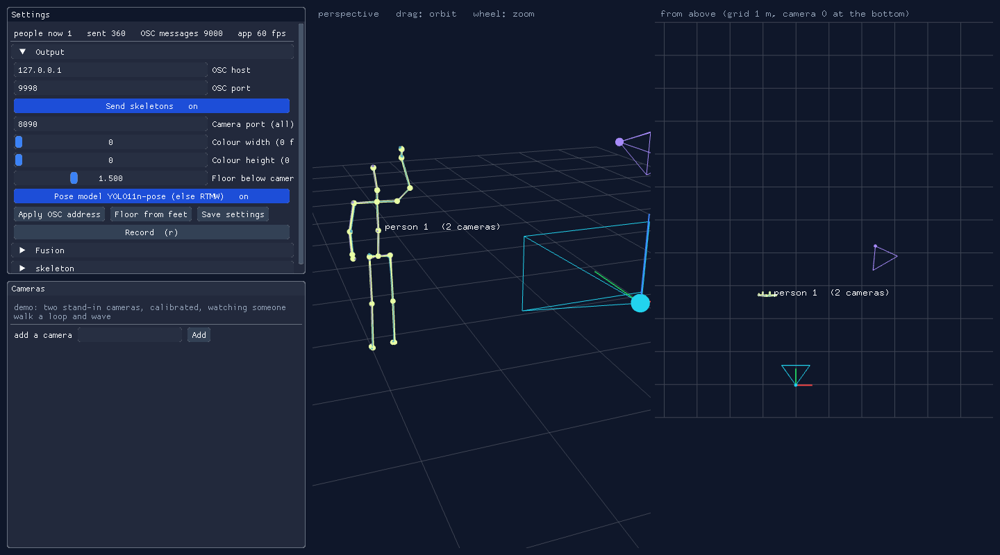
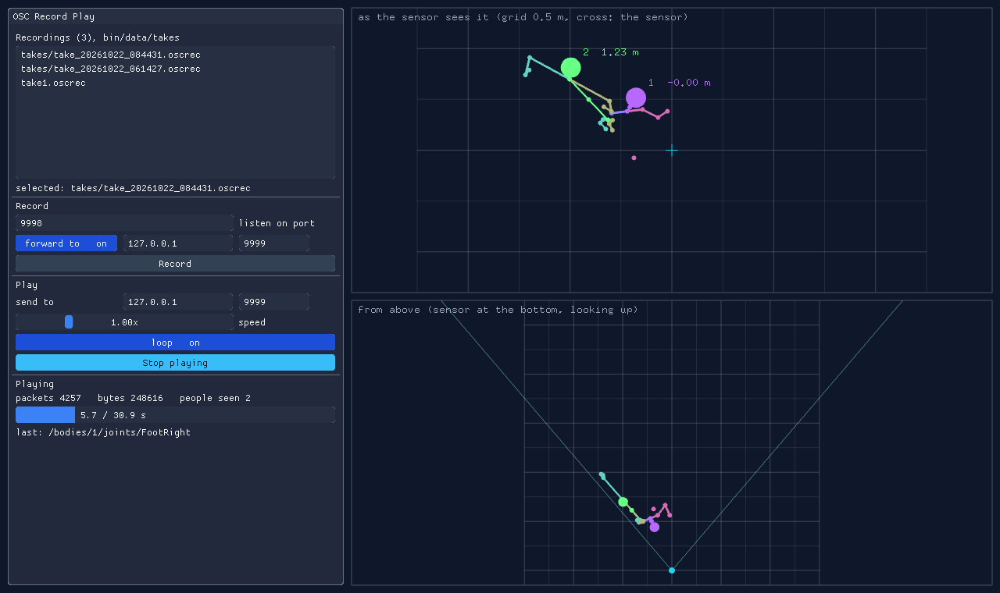

# SkeletonTracking

Two openFrameworks apps for tracking people with Orbbec Femto Mega depth cameras:

- **femtoSkeletonOsc** finds people with one or more Femto Megas on the network (up to 16) and sends their skeletons out over OSC.
- **oscRecPlay** records that OSC and plays it back with its timing, so whatever listens can be worked on without the cameras.

```
Femto Mega cameras --> femtoSkeletonOsc --OSC--> (oscRecPlay) --> anything that reads OSC
```



## Contents

- [Setup](#setup)
- [femtoSkeletonOsc](#femtoskeletonosc)
  - [The windows](#the-windows)
  - [One camera](#one-camera)
  - [Several cameras](#several-cameras): [network](#1-network), [placing](#2-placing-them), [turning on](#3-turning-them-on), [calibrating](#4-calibrating-a-camera), [checking](#5-checking-it), [merging](#merging)
  - [Recording the cameras](#recording-the-cameras)
  - [What it sends](#what-it-sends): [when](#when), [ids](#ids), [axes](#axes), [the 25 joints](#the-25-joints), [boxes](#boxes)
  - [Settings](#settings)
  - [How a skeleton is made](#how-a-skeleton-is-made)
  - [Files and logs](#files-and-logs)
  - [Testing without cameras](#testing-without-cameras)
- [oscRecPlay](#oscrecplay)
- [Troubleshooting](#troubleshooting)

## Setup

Clone this repository into `<openFrameworks>/apps/`, so each app sits three folders below openFrameworks.

1. **Addons.** `./get_addons.sh` clones the addons into `<openFrameworks>/addons`: ofxImGui, ofxOnnx, ofxOrbbec, ofxYoloPose and ofxRtmPoseTracker.
   - Pass `--update` to pull the ones you already have.
   - On macOS it also runs ofxOrbbec's `scripts/install_sdk.sh`, which fetches the Orbbec SDK (v2.10.6).
   - ofxOpenCv, ofxOsc and ofxNetwork come with openFrameworks.
2. **Build.** In each app run `make` (Release; `make Debug` for the debug build), then `make run`.
3. **Local network (macOS).** Allow the app on the local network when asked (System Settings → Privacy & Security → Local Network), or it cannot reach the cameras.
   - The apps ask for it in their `openFrameworks-Info.plist`, and the build signs the whole bundle (ad hoc, with `of.entitlements`) so macOS reads it.
   - A rebuild changes the signature, so macOS may ask again.

## femtoSkeletonOsc

### The windows

| where | what |
|---|---|
| **Settings** (top left) | the people being sent, the OSC message count and the frame rate; Output, with **Apply OSC address**, **Floor from feet** and **Save settings**; the **Record** button; Fusion, skeleton, and the pose model's settings |
| **Cameras** (bottom left) | what the search has found on the network; a section for each open camera; a line for each camera that is connecting or stopped; **add a camera** by its address |
| **perspective** (top middle) | the joined space in 3D, in camera 0's frame. Drag to orbit, wheel to zoom |
| **from above** (top right) | the same from above, 1 m grid. It zooms out by itself to keep every calibrated camera in view |
| **camera pictures** (along the bottom) | each camera's colour picture with the poses found in it, up to four in a row |

In the 3D views, each camera is a frustum in its own colour, with the skeletons it found drawn thin in that colour. The merged people are bold and labelled `person N (k cameras)`. A person found without a skeleton is an amber box, labelled "box" in the camera picture.

On / off settings are toggle buttons: blue and ending in "on" when on, plain and ending in "off" when off.

| key | |
|---|---|
| `space` | sending skeletons on / off |
| `r` | record every camera / stop |

### One camera

1. Connect the Femto Mega to the computer's network (directly or through a PoE switch). Its factory address is `192.168.1.10`; give the computer an address in the same subnet, such as `192.168.1.2`.
2. Start the app. It finds the camera within a few seconds and opens it as camera 0.
3. Set **OSC host** and **OSC port** in Output to where the skeletons should go, and press **Apply OSC address**.
4. Stand in view. You appear in the camera picture and in the 3D views, and `people now` counts you.

### Several cameras

Up to 16 Femto Megas can watch the same space (`kMaxCameras` in `ofApp.h`). Each camera runs a pose model on a thread of its own, so the computer, more than the app, sets how many keep up at 30 fps.
- **Camera 0** is the **reference**: the skeletons go out in its frame.
- **Every other camera** is placed relative to camera 0 by a **calibration** you do by walking about, with no target or markers.
- **A person seen by several cameras** becomes one merged skeleton with one id.

#### 1. Network

- Each Femto needs an address of its own. Change the others' with Orbbec Viewer, for example to `.11`, `.12` and `.13`.
- The computer needs an address in the same subnet.
- All the cameras use the same port, **Camera port (all)**, 8090 by default.
- PoE switches work.

#### 2. Placing them

- Each camera must **share a good part of its view with camera 0**: calibration needs a person both can see at once.
- The cameras do not need to be level: each one's accelerometer measures its pitch and roll.
- Keep **Level from accelerometer** on. With every camera levelled, calibration only has to find a turn about the vertical and a shift, which takes far less walking.

#### 3. Turning them on

- **Found automatically.** The app looks for cameras on the network every few seconds and opens each one it finds, up to 16.
  - A camera keeps its number by its address: one that was camera 2 last time is camera 2 again.
  - A new address takes the first free number.
- **Not found?** The search only reaches the computer's own subnet. For a camera elsewhere, type its address in **add a camera** and press **Add**.
- **What you see.** It connects within a few seconds and gets a section in the Cameras window, with its serial, frame count and accelerometer reading. Its picture joins the others along the bottom, up to four in a row. Cameras have eight colours, which repeat after camera 7.
- **Stopping one.** **Stop this camera** lets it go. It stays stopped (the search does not reopen it) until you press its **Start**.
- **Not calibrated yet.** A camera that is not calibrated is drawn and tracked, but its people are **not sent** ("not calibrated: its people are not sent").

#### 4. Calibrating a camera

Do this for each camera other than camera 0, against camera 0.

1. In the camera's section, turn **Collect points** on.
2. Have **one person, alone**, walk about where this camera and camera 0 both see them, for 20-30 seconds.
   - Cover the shared floor: walk loops, turns and side steps rather than one straight line, and move the arms.
   - A point is added for every joint both cameras place, but only when both see exactly one person within 0.1 s of each other.
   - The section shows the point count and their spread.
3. Press **Solve**.
   - It needs at least 60 points, spread at least 20 cm across the floor (in 3D for a camera without the accelerometer).
   - It is robust to stray joints (RANSAC): points more than 6 cm off are left out, and it needs 40 that agree.
   - It reports **rms**, how far the two cameras' joints still disagree over the points that fit, and how many points fit.
4. Solving saves the result to `bin/data/calibration.json` and turns Collect points off. The camera's people are sent from then on, and the view from above zooms out to take the camera in.

| result | meaning |
|---|---|
| rms under about 5 cm | good |
| rms over 10 cm | usually the person was not alone, or the shared view is small: **Clear points** and walk again |
| "need more points" | keep walking |
| "the points do not cover enough of the floor" | walk more of the shared space |
| "no consistent pose found" | the two cameras were not seeing the same person well |

**Moving a camera** means calibrating it again:
1. Press **Forget calibration**.
2. Press **Really forget?** within 3 seconds to confirm.
3. Repeat the calibration steps above.

Moving camera 0 means calibrating all the others.

#### 5. Checking it

- In the 3D views each camera's own skeletons are thin in its colour, and the merged person bold.
- With a good calibration, the thin skeletons from two cameras lie on top of each other, and the label says `person N (2 cameras)`.
- Each camera's frustum shows where it is.

#### Merging

Set in the Fusion settings:
- **Same person within** (0.5 m): bodies from different cameras this close together are one person. Each joint is the average of the cameras that saw it.
- **Track follows within** (0.8 m): a person keeps their id while they move less than this between updates.
- **Forget a person after** (1 s): how long a person is kept unseen.

The cameras run independently, without the sync cable. For two cameras to agree on someone moving fast they have to see them at nearly the same moment, which at 30 fps is within a frame.

### Recording the cameras

A recording (a take) holds what each camera gives (the colour, the depth registered to it, and the accelerometer's up vector), frame by frame with its time. A take plays back in place of a camera, through the same pose model, skeletons and OSC: this is how to try settings on the same movement again, or work without the cameras.

- **Record every camera:** **Record** in the Settings window, or `r`. One file each, with the same time in their names. Press again to stop.
- **Record one camera:** **Record / play back** in its section.
- **Play a take:** in **Record / play back**, pick a take and press **Play it as this camera**.
  - The camera is let go and the take feeds it, with a progress bar, **Loop** and **Speed** (0.1-2x).
  - **Back to the camera** reconnects.
- **Where:** `bin/data/femto_takes/cam<N>_<date>_<time>.femto`.
- **Size:** about 9.5 MB a second, about 570 MB a minute.
  - The colour is JPEG (quality 92); the depth is kept exactly (zlib).
  - Writing happens on a thread of its own, so recording does not slow the tracking. Frames it cannot keep up with are counted as "passed over".

The recorder and player are in ofxOrbbec (`ofxOrbbecRecording.h`), with the file format described there.

### What it sends

Skeletons go out as plain OSC messages over UDP, to the OSC host and port in Output (press **Apply OSC address** after changing them). Messages are not bundled.

```
/bodies/<id>/joints/<Joint>   float x, float y, float z, string "Tracked" | "NotTracked"
/boxes/<id>                   float cx, float cy, float cz, float sx, float sy, float sz
```

For example, one joint of person 7:

```
/bodies/7/joints/HandRight   0.412 0.236 -2.180 "Tracked"
```

#### When

- **Updates.** Each time a person is updated (whenever any camera has a new frame of them, about 30 times a second), all 25 of their joints are sent, one message each.
- **Missing joints.** A joint that was not placed this time is sent as `NotTracked`. Ignore its x y z.
- **Leaving.** Nothing is sent when someone leaves: a body whose messages stop has gone. **Forget a person after** (1 s) is how long the tracker keeps them, so a listener should forget a body after about that long without messages.

#### Ids

- **Bodies.** A body's `<id>` is the merged person's. It stays the same while they are followed, across cameras. Ids count up from 1 and are not reused while the app runs (they start again at 1 after a restart).
- **Boxes.** A box's `<id>` is `camera × 1000000 + the pose tracker's id`, so it never collides with a body's.

#### Axes

Metres, in **camera 0's levelled frame**: the origin is camera 0, turned so y is straight up whatever the camera's tilt. This is the Kinect v2's convention, which TrackerFemto and Mimic expect.

| axis | direction |
|---|---|
| x | toward the sensor's left (with **Flip X** on; off, toward its right) |
| y | up |
| z | negative away from the sensor: someone 2 m in front of it has z = -2 |

Every camera's people are put into this frame by its calibration, so the frame does not change as cameras are added.

#### The 25 joints

Named and numbered as the Kinect v2 (and Mimic's `Skeleton::JointIndex`) number them. The parent is the joint each one hangs from: the bones are drawn parent to joint.

| # | joint | parent | where it comes from |
|---|---|---|---|
| 0 | SpineBase | | halfway between the hips |
| 1 | SpineMid | SpineBase | halfway between SpineBase and SpineShoulder |
| 2 | SpineShoulder | SpineMid | halfway between the shoulders |
| 3 | Neck | SpineShoulder | 30% of the way from SpineShoulder to Head |
| 4 | Head | Neck | between the ears, or the nose when the ears are not seen |
| 5 | ShoulderLeft | SpineShoulder | keypoint |
| 6 | ElbowLeft | ShoulderLeft | keypoint |
| 7 | WristLeft | ElbowLeft | keypoint |
| 8 | HandLeft | WristLeft | RTMW: the middle finger's knuckle. YOLO: at the wrist |
| 9 | HandTipLeft | HandLeft | RTMW: the middle finger's tip. YOLO: `NotTracked` |
| 10 | ThumbLeft | WristLeft | RTMW: the thumb's tip. YOLO: `NotTracked` |
| 11 | ShoulderRight | SpineShoulder | keypoint |
| 12 | ElbowRight | ShoulderRight | keypoint |
| 13 | WristRight | ElbowRight | keypoint |
| 14 | HandRight | WristRight | as HandLeft |
| 15 | HandTipRight | HandRight | as HandTipLeft |
| 16 | ThumbRight | WristRight | as ThumbLeft |
| 17 | HipLeft | SpineBase | keypoint |
| 18 | KneeLeft | HipLeft | keypoint |
| 19 | AnkleLeft | KneeLeft | keypoint |
| 20 | FootLeft | AnkleLeft | RTMW: the big toe. YOLO: at the ankle |
| 21 | HipRight | SpineBase | keypoint |
| 22 | KneeRight | HipRight | keypoint |
| 23 | AnkleRight | KneeRight | keypoint |
| 24 | FootRight | AnkleRight | as FootLeft |

"Left" and "right" are the person's own. The joints made from others (the spine, neck and head) are only placed when the joints they come from are.

#### Boxes

`/boxes/<id>` is a person the detector found whose skeleton could not be built: arms crossed, turned away, or half out of view (fewer than **Joints to send a body** placed). It gives the centre (`cx cy cz`) and size (`sx sy sz`) of a box round them, in metres on the same axes. A box is about 0.3 m deep, a body's thickness behind the front of the person.

### Settings

Saved to `bin/data/settings.xml` on **Save settings** (it shows "saved") and on quitting.

**Output**

| setting | default | |
|---|---|---|
| OSC host, OSC port | 127.0.0.1, 9999 | where the skeletons go. Press **Apply OSC address** after changing them |
| Send skeletons | on | off: tracked and drawn, nothing sent (`space`) |
| Camera port (all) | 8090 | the Femtos' network port |
| Colour width, height | 0, 0 | 0 = the camera's fastest colour mode (1280x720) |
| Floor below camera 0 (m) | 1.5 | where the 3D views draw the floor. **Floor from feet** sets it from the feet of whoever is in view |
| Pose model YOLO11n-pose (else RTMW) | on | the pose model (see [how a skeleton is made](#how-a-skeleton-is-made)) |

**Each camera** (its section in the Cameras window; its address is saved with the settings)

| setting | default | |
|---|---|---|
| Stop this camera | | let it go until you press its Start |
| Level from accelerometer | on | pitch and roll from the accelerometer, not the sliders |
| Camera Upside Down | off | turn on only if the 3D view comes out upside down |
| Record / play back | | [recording the cameras](#recording-the-cameras) |
| Collect points, Solve, Clear points, Forget calibration | | every camera but camera 0: [calibrating](#4-calibrating-a-camera) |

**skeleton**

| setting | default | |
|---|---|---|
| Min keypoint score | 0.35 | a keypoint less sure than this is not used |
| Depth window (px) | 5 | the window a keypoint's depth is taken from |
| Min / Max depth (m) | 0.3 / 5 | depths outside are ignored |
| Camera pitch / roll (deg) | 0 / 0 | levelling by hand, for a camera not levelled by its accelerometer |
| Flip X | on | x toward the sensor's left, as the Kinect sends it |
| Joints to send a body | 6 | fewer placed: sent as a box |
| Min leg keypoint score | 0.5 | stricter for legs, which are often half out of view |
| Limb reach from the torso (m) | 0.8 | a limb joint farther in front of or behind the torso is re-placed |

**Fusion:** Same person within, Track follows within, Forget a person after (see [merging](#merging)).

**YOLO pose** (with YOLO11n-pose)

| setting | default | |
|---|---|---|
| Min person score | 0.4 | |
| Overlap to merge | 0.5 | |
| Overlap to follow | 0.3 | |
| Forget a person after | 0.5 s | |
| Min cutoff | 1.5 Hz | One Euro smoothing: lower is steadier standing still |
| Speed response | 0.01 | One Euro smoothing: higher is less lag on quick moves |

**Pose tracker** (with RTMW): ofxRtmPoseTracker's detector and tracking thresholds.

### How a skeleton is made

Each camera has a thread of its own that does steps 1-6 for every frame, so a frame's poses always meet that frame's depth.

1. **Frames.**
   - The Femto streams 1280x720 colour and 640x576 depth (narrow field, unbinned) at 30 fps.
   - The depth is registered to the colour **on the camera** (hardware D2C, with its factory calibration), so every colour pixel has a depth.
   - Depth and colour are paired by time (frame sync), and only complete pairs are used.
2. **People and keypoints**, with one of two models (**Pose model YOLO11n-pose (else RTMW)**):
   - **YOLO11n-pose** ([ofxYoloPose](https://github.com/danzeeeman/ofxYoloPose)), the default: people and their 17 body keypoints in one pass, about 30 times a second. No fingers or toes, so hands are put at the wrists and feet at the ankles.
   - **YOLOX-tiny + RTMW-x-l** ([ofxRtmPoseTracker](https://github.com/danzeeeman/ofxRtmPoseTracker)): finds people, then puts 133 whole-body keypoints on each, fingers and toes included. Slower.

   Both run through ONNX Runtime (CoreML on macOS). The models are downloaded into `bin/data/models` on the first run, and each person keeps an id from frame to frame.
3. **Depth for each keypoint.** The depths in a small window round it (**Depth window**) are taken, and the **near end** of them is used (a fifth of the way in) rather than the median. A limb is in front of whatever is behind it, so this keeps a hand from taking the wall's depth. Depths outside **Min / Max depth** are ignored.
4. **Fixing what cannot be.** Working out from the torso:
   - A limb joint that ends up farther from its parent than the bone could be (a wrist 60 cm from its elbow, say), or more than **Limb reach** in front of or behind the torso, is put at its parent's depth instead. It is dropped if even that does not fit.
   - A head too far from the shoulders gets their depth.
   - Leg keypoints need **Min leg keypoint score**, and are dropped at the bottom edge of the picture, where legs out of view are only guessed.
5. **Levelling.** The accelerometer gives which way is up, and the points are turned so y is vertical: the camera may hang tilted. Without the accelerometer, **Camera pitch / roll** do it by hand.
6. **A body or a box.** With at least **Joints to send a body** placed, it is a body, and the spine, neck and head are made from what was found. Otherwise the detector's box is taken out to the person's depth as a 3D box, with a body's thickness behind.
7. **Merged and sent.** A second thread takes every camera's new bodies, puts the calibrated cameras' bodies into camera 0's frame, merges them, and sends them as soon as any camera has something new (not at the window's frame rate).

### Files and logs

In `bin/data`:

| file | |
|---|---|
| `settings.xml` | the settings |
| `calibration.json` | each calibrated camera's pose relative to camera 0, its rms and inlier count |
| `models/` | the pose models, downloaded on the first run |
| `femto_takes/` | recordings of the cameras |
| `femtoSkeletonOsc.log` | the log, when the app is started without a terminal (from Finder) |

Debug builds (`make Debug`, `make RunDebug`) also log once a second where skeletons are lost: camera frames, tracker runs, people found, keypoints with depth, bodies built, ids, joints per body, and the accelerometer.

### Testing without cameras

Environment variables:

| variable | |
|---|---|
| `FEMTO_DEMO=1` | two stand-in cameras, calibrated, watch someone walk a loop and wave. No real camera is opened, and the settings are not saved on quitting |
| `FEMTO_PLAY=femto_takes/<take>.femto` | camera 0 plays that take from the start |
| `FEMTO_RECORD=1` | camera 0 is recorded from when it connects |
| `TRACKER_QUIT_AFTER=<s>` | quit after that many seconds, logging the counts |
| `FEMTO_SHOT=<file.png>` | save a screenshot after 6 s and quit |
| `FEMTO_SELFTEST=1` | check calibration and fusion on made-up data, log the results, quit |

For example:

```sh
FEMTO_PLAY=femto_takes/cam0_20261022_062955.femto TRACKER_QUIT_AFTER=30 make RunDebug
```

## oscRecPlay

Records the OSC that femtoSkeletonOsc sends and plays it back later with its timing, so whatever listens can be worked on and shown without the cameras.



- **Record:**
  - It listens on a port (9998), and each take goes to a file of its own, `bin/data/takes/take_<date>_<time>.oscrec`.
  - To record while your listener runs, point femtoSkeletonOsc at 9998 and turn **forward to** on, set to the listener's address (such as `127.0.0.1:9999`): every packet is passed on as it arrives.
  - Packets are kept byte for byte, so messages and bundles play back exactly as sent.
- **Recordings:**
  - Every take is listed, newest first (older ones in `bin/data` too).
  - Click one to select it for playing. A new recording is selected when it stops.
- **Play:** sends to a host and port (127.0.0.1:9999), at 0.1-4x speed, once or in a loop.
- **The skeletons going by** are drawn while recording or playing:
  - as the sensor sees them (its left on the left);
  - from above (the sensor at the bottom, its field of view drawn in);
  - each person in a colour of their own, left side blue, right side red, with their id and distance.
- **Settings** are kept in `bin/data/settings.json`.
- **`OSCREC_SHOT=<file.png>`** plays the newest take, saves a screenshot after 6 s and quits.

## Troubleshooting

| problem | try |
|---|---|
| "looking for cameras..." never ends, or "no cameras found on the network yet" | Check the computer has an address in the cameras' subnet. On macOS, check the app is allowed under Local Network (it may ask again after a rebuild). For a camera on another subnet, use **add a camera** |
| A camera says "not answering yet" | It is found but not connecting. Check its address and **Camera port (all)**, and that Orbbec Viewer is not holding it |
| "not calibrated: its people are not sent" | Calibrate that camera against camera 0 ([calibrating](#4-calibrating-a-camera)) |
| Calibration rms is high | Walk again alone, covering more of the floor both cameras see |
| The 3D view is upside down | Turn **Camera Upside Down** on for that camera |
| Hands or feet jump to the wall | Lower **Depth window** or **Limb reach from the torso**; raise **Min keypoint score** |
| Nothing arrives at the listener | Check **Send skeletons** is on, the OSC host and port, and that **Apply OSC address** was pressed |
